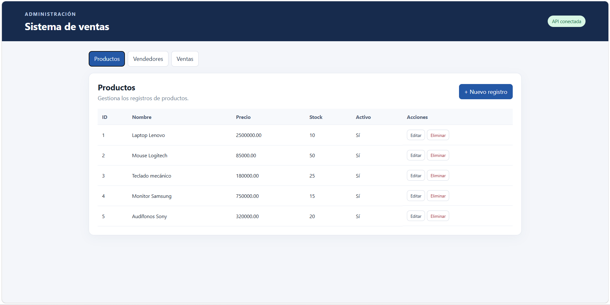

<div align="center">

# 🛒 Sistema de Ventas

**Aplicación web para gestionar productos, clientes y ventas**

Proyecto desarrollado con Angular 18, un backend propio y una base de datos PostgreSQL.


</div>

---

## 📋 Sobre el proyecto

Sistema de ventas que permite registrar y consultar productos, clientes y transacciones desde una interfaz web. La aplicación está dividida en tres capas independientes: un **frontend** que consume una **API** del lado del servidor, la cual se conecta a una base de datos **PostgreSQL**.

## ✨ Características

- 📦 Gestión de productos (crear, editar, consultar y eliminar)
- 👥 Registro y administración de clientes
- 🧾 Registro de ventas con su detalle
- 🔍 Búsqueda y consulta de la información almacenada
- 🔌 Comunicación entre frontend y backend mediante API REST
- 🗄️ Persistencia de datos en PostgreSQL

## 🛠️ Tecnologías

| Capa | Tecnología | Uso |
|------|------------|-----|
| Frontend | Angular 18 + TypeScript | Interfaz de usuario y navegación |
| Frontend | HTML5 y CSS3 | Estructura y estilos |
| Backend | Node.js + Express | API y lógica de negocio |
| Base de datos | PostgreSQL | Almacenamiento de la información |
| Control de versiones | Git y GitHub | Código fuente del proyecto |

## 📁 Estructura del proyecto

```
Sistema-de-ventas/
│
├── backend/          # API y lógica del servidor
├── database/         # Scripts y estructura de la base de datos
├── frontend/         # Aplicación Angular
│   └── src/
│       ├── app/      # Componentes de la aplicación
│       └── ...
│
├── .gitignore
└── README.md
```

## 🖼️ Vista previa



## 🚀 Cómo ejecutarlo

### Requisitos previos

- [Node.js](https://nodejs.org/) (versión LTS)
- [Git](https://git-scm.com/)
- [PostgreSQL](https://www.postgresql.org/download/) (instalado y en ejecución)

### 1. Clonar el repositorio

```bash
git clone https://github.com/nickjeferson019/Sistema-de-ventas.git
cd Sistema-de-ventas
```

### 2. Base de datos

1. Crea una base de datos nueva en PostgreSQL (con pgAdmin o con `psql`).
2. Ejecuta los scripts de la carpeta `database/` para crear las tablas.

### 3. Backend

```bash
cd backend
npm install
npm start
```

### 4. Frontend

```bash
cd frontend
npm install
npm start
```

Luego abre [http://localhost:4200](http://localhost:4200) en tu navegador.

## 👤 Autor

**Nick Jeferson Rivera Garces**

[](https://github.com/nickjeferson019)
